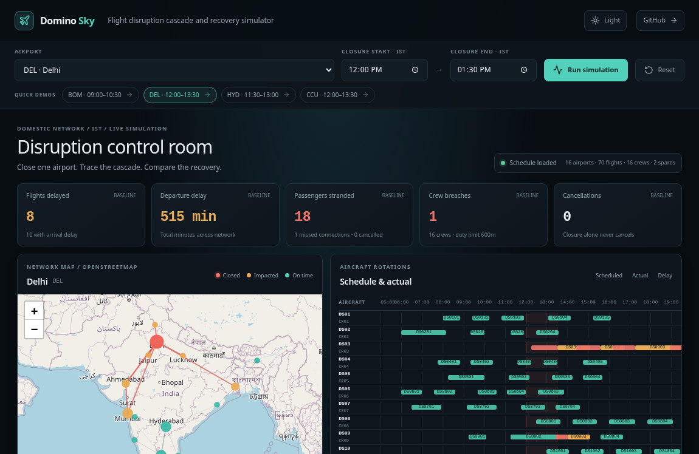
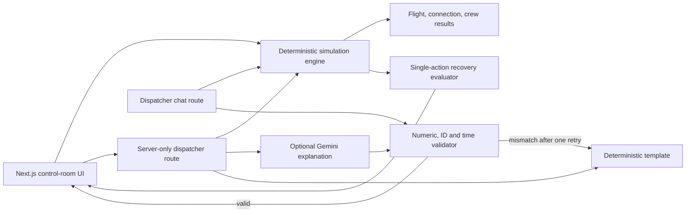

# Domino Sky — Flight Disruption Control Room

Domino Sky is a two-route simulator for airport closures across the supplied Indian domestic flight network. The intro at `/` launches a preconfigured scenario into the operations control room at `/simulator`. Choose a closure window, inspect the resulting aircraft and passenger cascade, and compare one-action recovery options. All operational figures come from deterministic TypeScript code; AI is optional and only writes explanations.



## Run locally

```bash
pnpm install
pnpm dev
```

The intro runs at `http://localhost:3000`; the simulator is at `http://localhost:3000/simulator`. Both work without environment variables. When an AI explanation provider is unavailable, the UI uses a deterministic template and never changes engine figures.

Run the automated tests and production build:

```bash
pnpm test
pnpm build
```

## Architecture



`src/engine/index.ts` contains the schedule rules and `simulate()`; `src/engine/recovery.ts` evaluates cancellations and spare-aircraft swaps by rerunning that same simulator. `/api/dispatcher` computes its own engine result on the server and sends only that JSON to Gemini. The browser never receives `GEMINI_API_KEY`. `/api/chat` answers from the current simulation and uses the same validator.

## Engine rules and assumptions

Times are local IST and convert from `HH:MM` to minutes after midnight. For each aircraft, flights are processed by `leg_order`:

1. `actual departure = max(scheduled departure, previous actual arrival + 30 minutes)`.
2. If the actual departure is at the closed airport and falls inside `[start, end)`, it moves to the reopening time.
3. Arrival is actual departure plus the supplied block time. If arrival is at the closed airport and falls inside `[start, end)`, the flight holds until reopening.
4. A delayed flight has an actual departure later than its scheduled departure. Arrival delay is tracked separately. Closure alone never cancels a flight; cancellations are created only by a recovery action.
5. A connection is broken when the connecting flight departs before inbound actual arrival plus its minimum connection time, or when either flight is cancelled. Stranded passengers are passengers on cancelled flights plus passengers on broken connections whose flights are both non-cancelled. This avoids double-counting passengers on connections attached to cancelled flights.
6. Crew duty is the last non-cancelled arrival minus duty start; a breach is strictly more than 600 minutes. Slack is reported for every crew.
7. Delay causes are structured as `closure_origin`, `closure_destination`, `late_inbound` (including the prior flight ID), or `cancelled_by_action`; the UI renders the root-cause chain.

Recovery candidates are evaluated one at a time. A spare swap requires the spare base to equal the flight origin and the spare to be available at least 30 minutes before the new departure. The spare then takes the selected flight and the remainder of that aircraft rotation; the original tail keeps only earlier legs. Invalid swaps are rejected with a reason.

The score is `departure-delay minutes × 1 + stranded passengers × 3 + crew breaches × 200 + cancellations × 150`. The weights live in one engine config object and are visible in the UI. Only strictly score-improving actions are recommended; the baseline is always shown.

## How the dispatcher is kept honest

Gemini receives the engine output, not raw schedule instructions from the browser. Its response must be structured JSON (`recommended_action_id`, `summary`, `why[]`, `numbers_cited[]`). A server-side validator checks numeric values plus cited airport/flight/crew/connection IDs and `HH:MM` times against engine output. A mismatch triggers one retry; a second mismatch or unavailable Gemini uses the deterministic template. The badge distinguishes a verified model explanation from a template. Simulation values never depend on Gemini.

## Demo scenario results

These are the baseline results before any recovery action. Cancellations are zero in every closure-only scenario.

| Closed airport | Window (IST) | Delayed flights | Departure-delay minutes | Stranded passengers | Broken connections | Crew breaches | Cancellations |
| --- | --- | ---: | ---: | ---: | --- | --- | ---: |
| BOM | 09:00–10:30 | 6 | 275 | 0 | None | None | 0 |
| DEL | 12:00–13:30 | 8 | 515 | 18 | CX10 | CR03 | 0 |
| HYD | 11:30–13:00 | 7 | 250 | 99 | CX11, CX12, CX17 | CR07 | 0 |
| CCU | 12:00–13:30 | 9 | 400 | 34 | CX14, CX21 | CR11 | 0 |

No-closure baseline: **0 delayed, 0 delay minutes, 0 stranded, 0 crew breaches, 0 cancellations**. Verified closure rules: departures within the closure wait until it ends, arrivals within it are held to reopening, turnaround remains 30 minutes, and closure alone never cancels a flight. The HYD and CCU departure-delay minute totals above are the engine outputs; the requested scenario checks (including the BOM 275 and DEL 515 minute totals) are asserted in the test suite.

The BOM scenario affects BOM, PNQ, GOI, HYD, and BLR. The figures above are produced by the same engine used by the UI and covered by Vitest assertions.

## Limitations

- The supplied `data/flight_network.json` is a static one-day schedule; the simulator does not connect to airline operations, weather, air-traffic, or booking systems.
- Passenger counts are aggregate counts supplied by the dataset. Rebooking, fare class, individual passenger itineraries, aircraft capacity constraints, and crew reassignment are not modelled.
- Recovery evaluation considers one action at a time, not combinations or a full optimization plan. A swap models tail reassignment but not towing, positioning, maintenance, or crew reassignment.
- The map uses OpenStreetMap tiles and therefore needs an internet connection to show geographic basemap tiles.
- Gemini output is optional, can fall back to a template, and never changes calculated figures.
